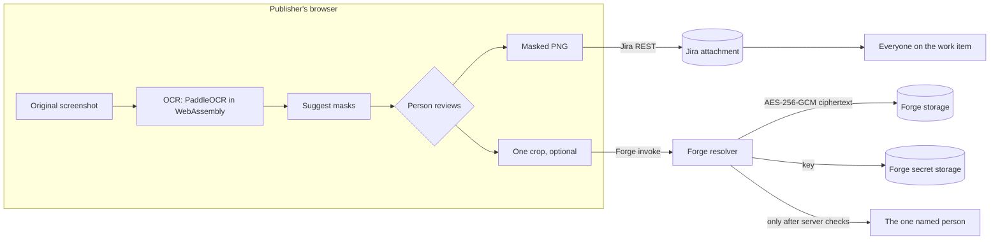
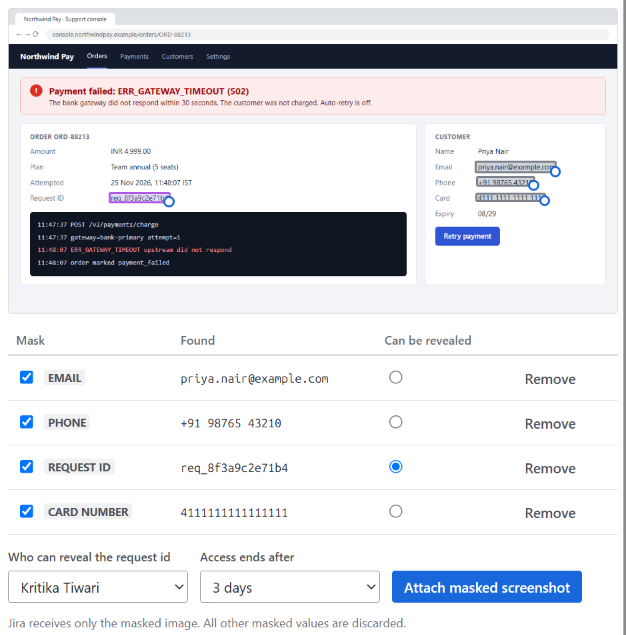
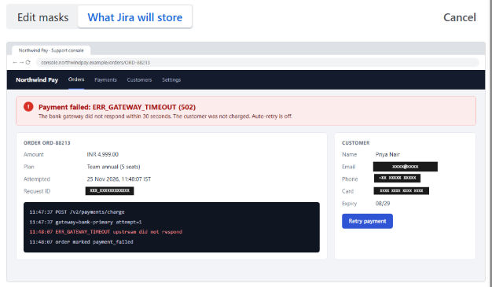
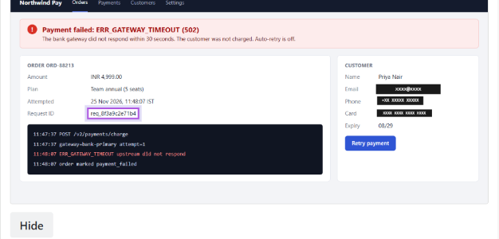

# Screenshot Shield for Jira

**Everyone sees the error. Only the person you choose can reveal the private detail.**

A Forge Custom UI panel for Jira work items. It finds private details in a screenshot **in the browser**, attaches
only a masked copy to Jira, and can let one named person reveal one masked value for a limited time.

Built for Codegeist 2026 (Apps for Business Teams). [Demo video](https://youtu.be/nXrCs4PB3E0) ·
[Architecture](docs/ARCHITECTURE.md) · [Security model](docs/SECURITY.md) · [Judge setup](JUDGE_SETUP.md)

## The problem

A payment fails and someone drops a screenshot on the ticket. The error is in it. So are the customer's email,
phone number and card number, now visible to everyone who can open the work item and in every download.

## How it works



The original image is not uploaded. The only unmasked pixels that reach the server are the single crop the
publisher chose to make revealable.

## What it looks like

All customer data shown is made up.

**Review the suggested masks**



**Check what Jira will store**



**The named person reveals the value in place**



## Features

| Feature | Detail |
| --- | --- |
| Input | Upload, drop or paste a PNG, JPEG or WebP up to 8 MB |
| Suggested masks | Email, international and formatted phone numbers, Luhn-checked card numbers, common secret-key formats, labelled or shaped request and trace IDs |
| Left readable | Error codes, order numbers, versions and ordinary text |
| Review | Draw, move, resize or remove masks, then preview exactly what Jira will store |
| Reveal | One value, one named person, for 1, 3, 7 or 30 days |
| Revoke | Publisher only; deletes the key and the encrypted crop |
| Clean-up | Deleting the attachment in Jira removes the app's data the next time the panel lists it |

## Who can do what

| Action | Publisher | Named person | Anyone else who can see the work item |
| --- | --- | --- | --- |
| Open the masked attachment | Yes | Yes | Yes |
| Reveal the value | No | Yes, until expiry or revocation | No |
| Revoke | Yes | No | No |

Jira shows the panel's buttons to people who can edit the work item.

## Repository map

```text
manifest.yml                 Forge app: issue panel, resolver, scopes, content security policy
src/                         Backend (Forge function, Node 22)
  index.js                   Registers the five resolver functions
  resolvers/screenshots.js   List, publish, reveal, revoke, clean-up
  access/grants.js           Pure access decisions (reveal, revoke, expiry)
  crypto/aes.js              AES-256-GCM encrypt and decrypt
  storage/keys.js            Storage key names
static/panel/                Frontend (React + Vite)
  src/App.jsx                Upload, review and publish flow
  src/Published.jsx          Published screenshots, reveal and revoke
  src/masks/detect.js        Rules that suggest masks from OCR text
  src/masks/Editor.jsx       Draw, move and resize masks
  src/export/maskPng.js      Paints masks and cuts the revealable crop
  src/ocr/paddle.js          Runs OCR in the browser
  src/api/jira.js            Jira REST and Forge invoke calls
  src/copy.js                User-facing wording
  public/models/             OCR model weights
  dev/mockBridge.js          Local stand-in for the Forge bridge (never deployed)
tests/                       Node tests: access, crypto, detection, resolvers
e2e/full_flow.py             Live two-account check on a real Jira site
scripts/                     Asset preparation, sample screenshot, test browser profiles
fixtures/                    Made-up sample screenshot and its HTML source
docs/                        Architecture and security model
```

## Run it

You need Node 22 and, to deploy, the [Forge CLI](https://developer.atlassian.com/platform/forge/cli-reference/).

```bash
npm run setup          # install backend and panel dependencies
npm test               # 19 tests
npm run build:panel    # copy the WebAssembly runtime and build the panel
```

Try the panel without Jira (a local stand-in, with no real access control):

```bash
npm run prepare:assets
npm --prefix static/panel run dev -- --mode mock
```

Open `http://localhost:5173/?as=shreyash` as the publisher and `?as=kritika` as the second person.

Deploy to your own Forge app:

```bash
forge register         # once, to get your own app id
npm run deploy         # development, or: npm run deploy:prod
forge install          # choose Jira and your site
```

## Limits

- Suggestions are a review aid. They cannot prove an image holds nothing sensitive.
- Revoking cannot take back what someone already saw, copied or photographed.
- The server does not check that the attached image is masked; it trusts the publisher's browser.
- The full list is in the [security model](docs/SECURITY.md).

## Licence

Apache-2.0. See [LICENSE](LICENSE) and [THIRD_PARTY_NOTICES.md](THIRD_PARTY_NOTICES.md).
