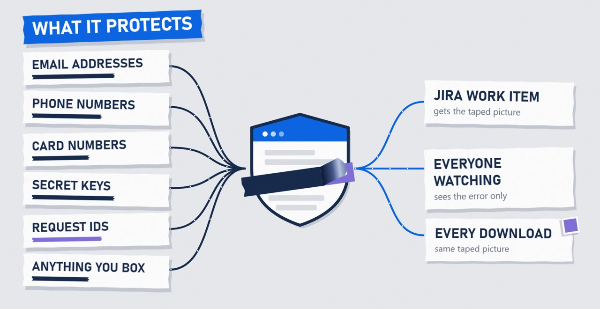
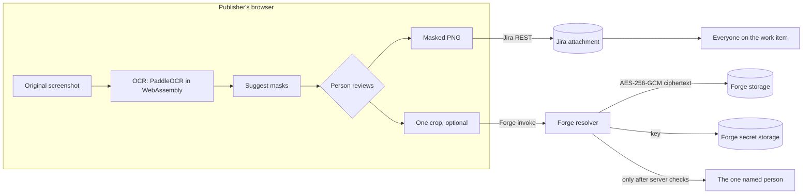
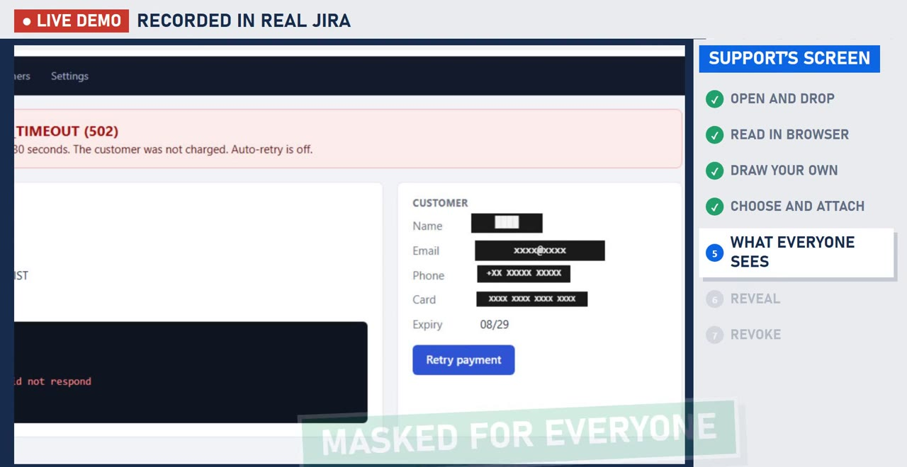
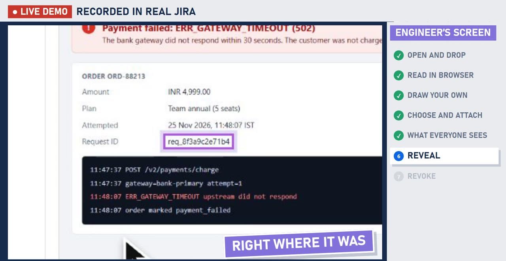
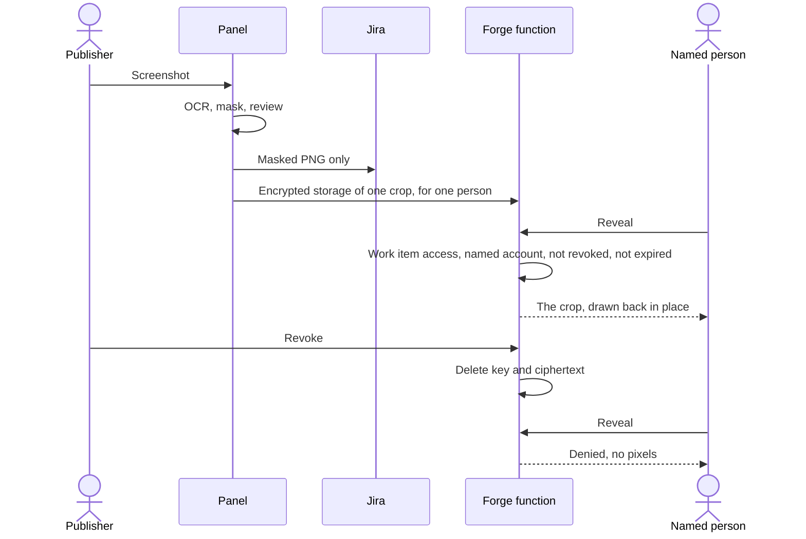
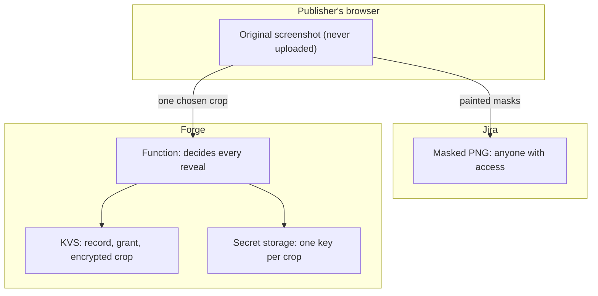

# Screenshot Shield for Jira

**Everyone sees the error. Only the person you choose can reveal the private detail.**

A Forge Custom UI panel for Jira work items. It finds private details in a screenshot **in the browser**, attaches
only a masked copy to Jira, and can let one named person reveal one masked value for a limited time. Built for
Codegeist 2026 (Apps for Business Teams).

[Architecture](docs/ARCHITECTURE.md) · [Security model](docs/SECURITY.md) · [Judge setup](JUDGE_SETUP.md) · [Install on your Jira site](https://developer.atlassian.com/console/install/a137a727-27f8-46c0-9de3-e577d4dad329?signature=AYABeDtgZOrqdxE3dUGCJgS6h9oAAAADAAdhd3Mta21zAEthcm46YXdzOmttczp1cy13ZXN0LTI6NzA5NTg3ODM1MjQzOmtleS83MDVlZDY3MC1mNTdjLTQxYjUtOWY5Yi1lM2YyZGNjMTQ2ZTcAuAECAQB4CxqLTo9l4lqXuFjNim1xJM%2Bp%2F3TVP9xHS2BrU5DRRucB8Hj7T4MmnIhU5akWl5pzoQAAAH4wfAYJKoZIhvcNAQcGoG8wbQIBADBoBgkqhkiG9w0BBwEwHgYJYIZIAWUDBAEuMBEEDOD0JAw07f27V8F8XgIBEIA7dKrAKCYfrYkYJtQvIeUgMqQ8rhTDohP39PayEcH3s5n%2B682bPPVY%2Bw5D9USPs5o77ccLi%2Be7qlomgOIAB2F3cy1rbXMAS2Fybjphd3M6a21zOmV1LXdlc3QtMTo3MDk1ODc4MzUyNDM6a2V5LzQ2MzBjZTZiLTAwYzMtNGRlMi04NzdiLTYyN2UyMDYwZTVjYwC4AQICAHi9bVMAkme4qVQX1fQHo6ePw3H40A7cGfz7yrmSfBWMXgFKpXbOptH67Vllbilcs9HrAAAAfjB8BgkqhkiG9w0BBwagbzBtAgEAMGgGCSqGSIb3DQEHATAeBglghkgBZQMEAS4wEQQMMkyFEahs9%2B36EKTQAgEQgDuY3llj2%2F5UvFALfautqlMgDSNgY2ShYcRmYu8qPeeGgsWT7GJWGR0k7Rw6aCg3k06R%2FkiQiSYBHI%2BWqwAHYXdzLWttcwBLYXJuOmF3czprbXM6dXMtZWFzdC0xOjcwOTU4NzgzNTI0MzprZXkvNmMxMjBiYTAtNGNkNS00OTg1LWI4MmUtNDBhMDQ5NTJjYzU3ALgBAgIAeDYASx0XCjkny4iLV6vz%2BKtEGSGT6kdt0QRpkn6D%2FlVEAaNe4JzmVWrpJEHBN1biRTQAAAB%2BMHwGCSqGSIb3DQEHBqBvMG0CAQAwaAYJKoZIhvcNAQcBMB4GCWCGSAFlAwQBLjARBAyxcWouXocdF4f3GHICARCAO%2Fs1ZbTP7YgbQmqybuh8fJ%2FTJMdJfeUsg2TiOhwgv4KF5phAN8spaXgKGHzbaK5dI7AhcAmBohzzRAh3AgAAAAAMAAAQAAAAAAAAAAAAAAAAANIVJ0zg3fYwd16AVEXf7E3%2F%2F%2F%2F%2FAAAAAQAAAAAAAAAAAAAAAQAAADIcER0UddXkS65Rkmbw0UwpiE7ZZhq465wn4QbGFEurH40qvVgDagtfNxw3wHSbtAh7LB20hCw1p017yTDMbA6c14A%3D&product=jira) · [Privacy](PRIVACY.md)

## Watch it (2:35)

**https://www.youtube.com/watch?v=nXrCs4PB3E0**

[](https://www.youtube.com/watch?v=nXrCs4PB3E0)

All customer data shown here is made up.

## The problem

A payment fails and someone drops a screenshot on the ticket. The error is in it. So are the customer's email,
phone number and card number, now visible to everyone who can open the work item and in every download.

## What it protects



## What is in this repository

| Piece | What it is |
| --- | --- |
| **Panel** (`static/panel`) | React Custom UI: load a screenshot, OCR it in the browser, review masks, attach, reveal, revoke |
| **Backend** (`src`) | Forge function with five resolver calls; access decisions, AES-256-GCM, Forge storage |
| **Detector** (`static/panel/src/masks/detect.js`) | Deliberately narrow rules, so the error stays readable |
| **Tests** (`tests`, `e2e`) | 19 Node tests, plus a two-account check on a real Jira site |
| **Docs** (`docs`) | [Architecture](docs/ARCHITECTURE.md) and [security model](docs/SECURITY.md) |

## How it works



1. **Load.** Upload, drop or paste a screenshot into the panel.
2. **Read.** OCR runs in the browser and rules suggest what to mask.
3. **Review.** Move, resize, remove or draw masks; compare with exactly what Jira will store.
4. **Choose.** Optionally pick one value, one person and how long (1, 3, 7 or 30 days).
5. **Attach.** Jira receives the masked image. The chosen crop is encrypted by the Forge function.
6. **Reveal.** The named person sees the value in place, on their screen only.
7. **Revoke.** The publisher destroys the stored value whenever they like.

## In real Jira

**Review the suggested masks, then pick one value and one person.**


**Everyone else sees the masked picture.**



**The named person reveals the value in place.**



## From publish to revoke



## Where each thing lives



## Who can do what

| Action | Publisher | Named person | Anyone else who can see the work item |
| --- | --- | --- | --- |
| Open the masked attachment | Yes | Yes | Yes |
| Reveal the value | No | Yes, until expiry or revocation | No |
| Revoke | Yes | No | No |

Jira shows the panel's buttons to people who can edit the work item.

## Features

| Feature | Detail |
| --- | --- |
| Input | PNG, JPEG or WebP up to 8 MB |
| Suggested masks | Email, international and formatted phone numbers, Luhn-checked card numbers, common secret-key formats, labelled or shaped request and trace IDs |
| Left readable | Error codes, order numbers, versions and ordinary text |
| Revoke | Publisher only; deletes the key and the encrypted crop |
| Clean-up | Deleting the attachment in Jira removes the app's data the next time the panel lists it |

## What has been checked

- `npm test`: 19 tests (access decisions, encryption, detection, resolvers against stand-in Jira and storage).
- Two real accounts against the **production** Forge deployment on a real Jira Cloud site: protect, publisher
  denied, named person reveals, revoke, named person denied. One site, made-up data, Chrome.
- On the sample screenshot, email, phone, card number and request ID were suggested and the error was left readable.
  No detection accuracy rate has been measured.

## What it is not

- Not a guarantee that an image holds nothing sensitive. Suggestions are a review aid.
- Not able to take back what someone already saw, copied or photographed.
- Not a defence against a dishonest publisher: the server does not check that the attached image is masked.
- Not an audit trail: reveals are not logged.

The full list is in the [security model](docs/SECURITY.md).

## Repository map

```text
manifest.yml                 Forge app: issue panel, resolver, scopes, content security policy
src/                         Backend (Forge function, Node 22)
  index.js                   Registers the five resolver functions
  resolvers/screenshots.js   List, publish, reveal, revoke, clean-up
  access/grants.js           Pure access decisions (reveal, revoke, expiry)
  crypto/aes.js              AES-256-GCM encrypt and decrypt
  storage/keys.js            Storage key names
static/panel/                Frontend (React + Vite)
  src/App.jsx                Upload, review and publish flow
  src/Published.jsx          Published screenshots, reveal and revoke
  src/masks/detect.js        Rules that suggest masks from OCR text
  src/masks/Editor.jsx       Draw, move and resize masks
  src/export/maskPng.js      Paints masks and cuts the revealable crop
  src/ocr/paddle.js          Runs OCR in the browser
  src/api/jira.js            Jira REST and Forge invoke calls
  src/copy.js                User-facing wording
  public/models/             OCR model weights
  dev/mockBridge.js          Local stand-in for the Forge bridge (never deployed)
tests/                       Node tests: access, crypto, detection, resolvers
e2e/full_flow.py             Live two-account check on a real Jira site
scripts/                     Asset preparation, sample screenshot, test browser profiles
fixtures/                    Made-up sample screenshot and its HTML source
docs/                        Architecture, security model, images
```

## Run it

You need Node 22 and, to deploy, the [Forge CLI](https://developer.atlassian.com/platform/forge/cli-reference/).

```bash
npm run setup          # install backend and panel dependencies
npm test               # 19 tests
npm run build:panel    # copy the WebAssembly runtime and build the panel
```

Try the panel without Jira (a local stand-in, with no real access control):

```bash
npm run prepare:assets
npm --prefix static/panel run dev -- --mode mock
```

Open `http://localhost:5173/?as=shreyash` as the publisher and `?as=kritika` as the second person.

Deploy to your own Forge app:

```bash
forge register         # once, to get your own app id
npm run deploy         # development, or: npm run deploy:prod
forge install          # choose Jira and your site
```

## Licence and credits

Apache-2.0, see [LICENSE](LICENSE). PaddleOCR (Apache-2.0), onnxruntime-web (MIT) and validator.js (MIT) are listed
in [THIRD_PARTY_NOTICES.md](THIRD_PARTY_NOTICES.md). Developed with AI coding assistance (Claude Code). All sample
data is synthetic.
