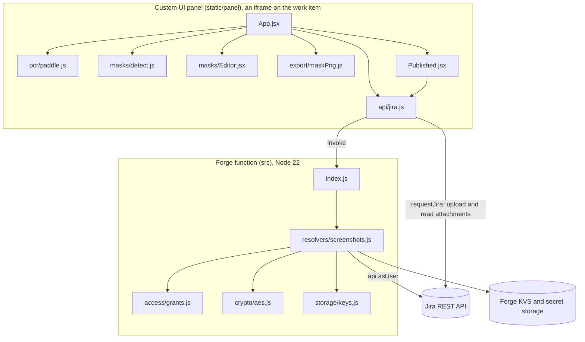
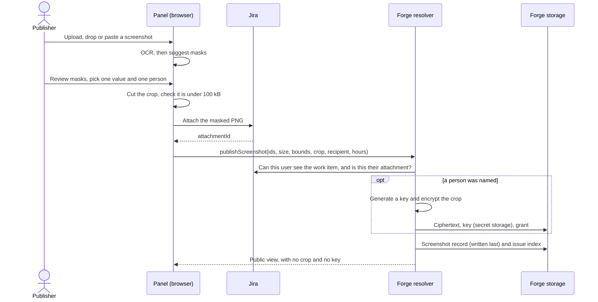
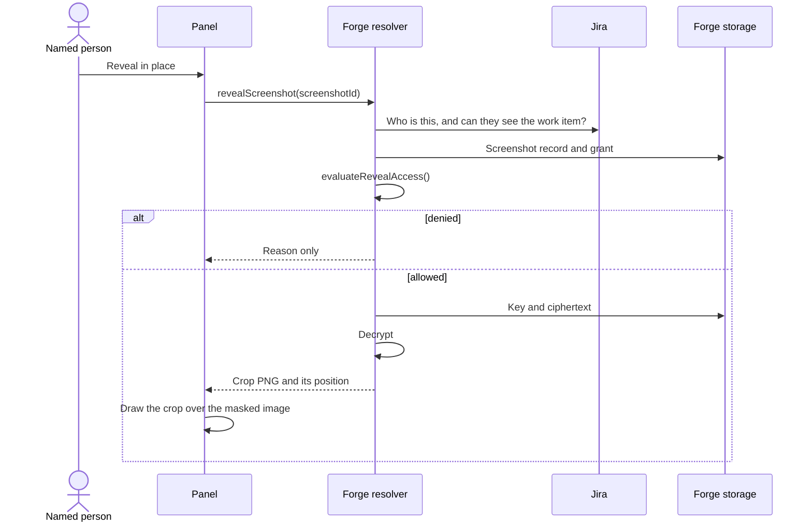
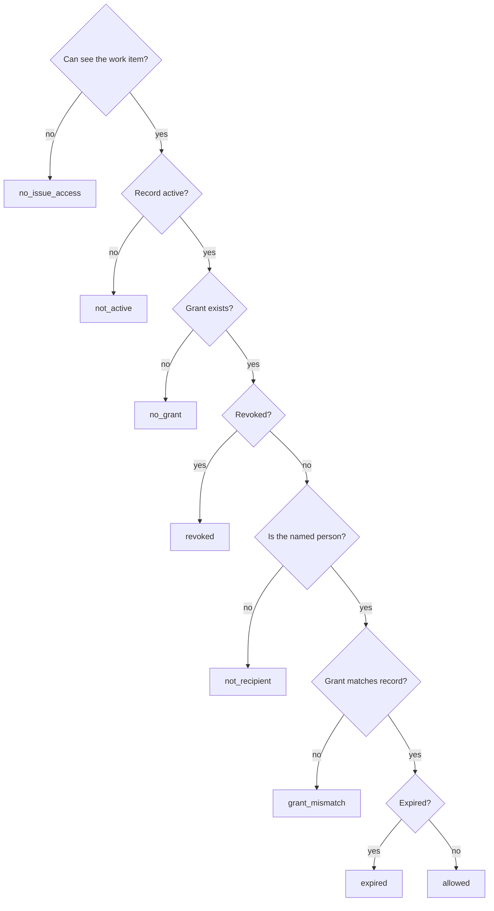
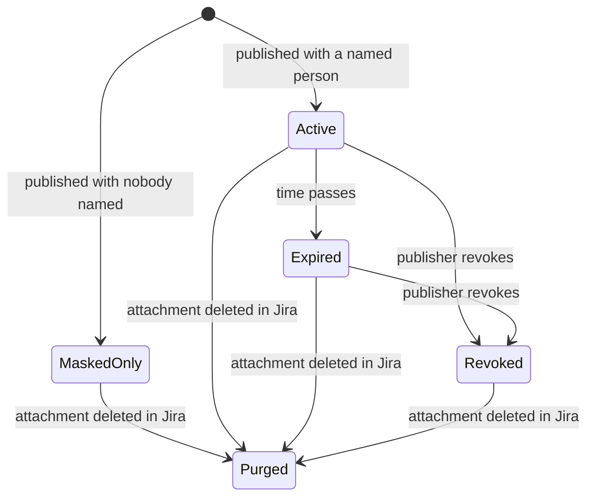
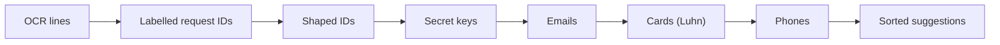

# Architecture

## Components

The manifest declares no external network access. OCR models and the WebAssembly runtime are bundled with the panel.

## Publish

The image is attached before the app records it. If recording fails, the masked attachment stays on the work item
and the panel says so.

## Reveal

## Access decision

`evaluateRevealAccess` in [grants.js](../src/access/grants.js) is a pure function. The checks run in this order and
the first failure wins.

## Life of a published screenshot

Revoking deletes the key and ciphertext. Purging happens when the panel next lists the work item's screenshots; if
Jira's attachment list cannot be read, nothing is purged.

## Stored data

| Key | Store | Contents |
| --- | --- | --- |
| `shot:<id>` | KVS | Issue id and key, attachment id, filename, image size, publisher, revealable bounds, status, time |
| `grant:<id>` | KVS | Recipient, issuer, expiry, revoked flag |
| `crop:<id>` | KVS | AES-256-GCM ciphertext of the crop, with IV and auth tag |
| `key:<id>` | Secret storage | The 256-bit key for that one crop |
| `issue:<ref>:shots` | KVS | Up to 50 screenshot ids, indexed by both issue id and issue key |

## Resolver API

| Function | Input | Returns | Server checks |
| --- | --- | --- | --- |
| `listScreenshots` | `issueId`, `issueKey` | Items with `canReveal`, `canRevoke`, grant summary | Can see the work item |
| `listAssignable` | `issueKey`, `query` | Account ids and display names | Jira's assignable-user search, run as the user |
| `publishScreenshot` | Ids, size, optional bounds, crop, recipient, hours | The new item | Can see the work item; own attachment; PNG crop under 100 kB; at most 720 hours |
| `revealScreenshot` | `screenshotId` | Crop and bounds, or a reason | `evaluateRevealAccess` |
| `revokeGrant` | `screenshotId` | The updated item | Caller is the publisher |

## Mask suggestions

[detect.js](../static/panel/src/masks/detect.js) works on OCR lines (text plus a box).

Earlier rules win: a suggestion that overlaps one already made is dropped, so a numeric ID is not mistaken for a
phone or card. Where only part of a line is private, the box is estimated from character positions and widened
slightly, which is one reason a person reviews it. The rules are deliberately narrow: a screenshot exists to show an
error, so masking too much is also a failure.

## Build

`npm run build:panel` copies the onnxruntime WebAssembly files into `static/panel/public/ort`, then Vite builds into
`static/panel/dist`, which the manifest serves. The content security policy allows `unsafe-eval` and `blob:` scripts
for the OCR runtime, and inline styles.

## Tests

| File | Covers |
| --- | --- |
| `tests/grants.test.mjs` | Reveal and revoke decisions |
| `tests/aes.test.mjs` | Round trip; a wrong key fails |
| `tests/detect.test.mjs` | What is suggested and what stays readable |
| `tests/resolvers.test.mjs` | Publish, reveal, revoke and clean-up against stand-in Jira and storage |
| `e2e/full_flow.py` | Two real accounts: protect, deny, reveal, revoke, deny (needs your own site) |
