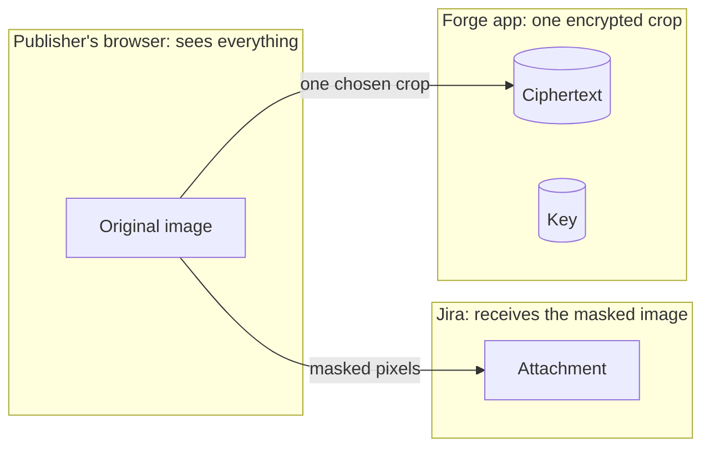

# Security model

## Trust boundaries

## What the design holds to

| Property | Where it is enforced |
| --- | --- |
| The original screenshot is not uploaded | `App.jsx` uploads only the painted canvas |
| A crop is stored only when a person is named | `publishScreenshot` |
| Each crop is encrypted with its own key, kept in Forge secret storage | `crypto/aes.js`, `publishScreenshot` |
| Every reveal is decided on the server | `revealScreenshot`, `access/grants.js` |
| A denial returns a reason and no pixels | `revealScreenshot` |
| Only the publisher can revoke, and revoking destroys key and ciphertext | `revokeGrant` |
| Jira users' email addresses are not passed to the panel | `listAssignable` |

## Known limits

- **Detection can miss things.** OCR and rules are a review aid. Names, addresses and unusual formats need a drawn mask.
- **The publisher's browser is trusted.** The server does not inspect the attachment or compare the crop with it.
  Someone calling the app's functions directly could record an unmasked image they had uploaded themselves.
- **Seen is seen.** Revocation and expiry stop future reveals only.
- **Expired data stays stored** until the publisher revokes or the attachment is deleted.
- **No audit log** records who revealed what, or when.
- **Metadata is visible** to people who can see the work item: publisher name, recipient name, expiry and where the
  revealable area is.
- **The panel lists up to 50 screenshots** per work item.
- Forge and Jira are trusted, including anyone who can change and deploy this app.
